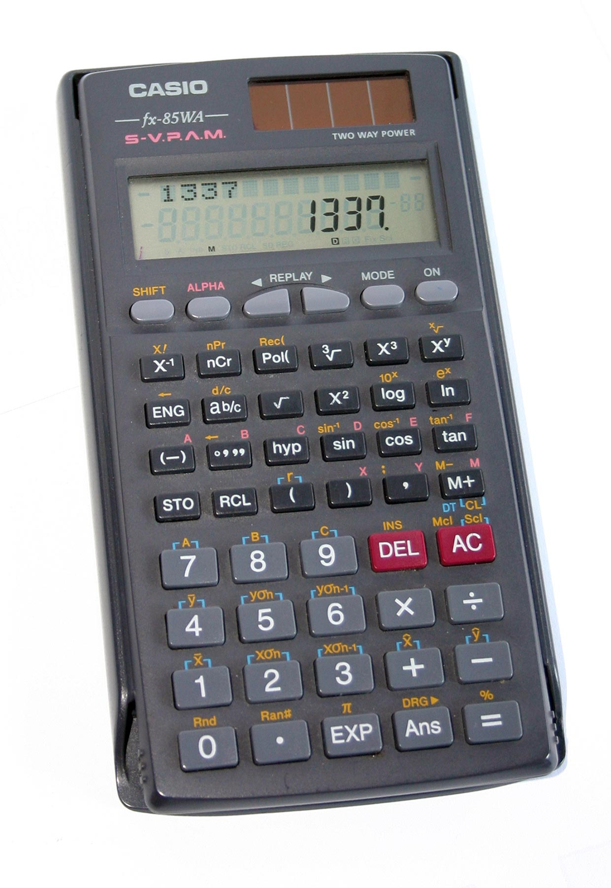

```{=html}
<style>
body{
  background-color:#f7f6ed;
  font-size:130%;
  text-align:justify;
}
</style>
```

# Introducción

La **combinatoria** es la rama de las matemáticas que estudia las formas de contar, ordenar y seleccionar elementos de un conjunto sin tener que enumerar todas las posibilidades una por una. Es fundamental en probabilidad, investigación de operaciones, informática, educación y análisis de decisiones.

Este documento sigue la organización de la infografía *Fórmulas de combinatoria* (página 1): variaciones, variaciones con repetición, permutaciones, permutaciones con repetición, combinaciones, combinaciones con repetición y relaciones notables. Se añaden ejemplos desarrollados y código reproducible en R.

::: callout-tip
## La pregunta clave

Antes de elegir una fórmula, pregúntese:

1.  **¿Importa el orden?**
2.  **¿Se pueden repetir los elementos?**
3.  **¿Se utilizan todos los elementos o solo una parte?**
:::

## Mapa de decisión

```{mermaid}
flowchart TD
    A["¿Importa el orden?"] -->|Sí| B["¿Se usan todos los elementos?"]
    A -->|No| C["Combinaciones"]
    B -->|Sí| D["Permutaciones"]
    B -->|No| E["Variaciones"]
    D --> F["¿Hay elementos repetidos?"]
    E --> G["¿Se permite repetir?"]
    C --> H["¿Se permite repetir?"]
    F -->|No| I["P = n!"]
    F -->|Sí| J["Permutación con repetición"]
    G -->|No| K["Variación sin repetición"]
    G -->|Sí| L["Variación con repetición"]
    H -->|No| M["Combinación sin repetición"]
    H -->|Sí| N["Combinación con repetición"]
```

# .Conceptos básicos

## .Factorial

Para un entero no negativo (n), el factorial es el producto de todos los enteros positivos desde 1 hasta (n). Por definición, (0! = 1).

$$n! = n(n-1)(n-2)\cdots 2 \cdot 1, \qquad 0! = 1.$$

En R se calcula con `factorial()`:

```{r}
factorial(5)
factorial(0)
```

## .Notación

Se utilizan (m) para el número total de elementos y (n) para el número de posiciones o elementos seleccionados. Algunas fuentes intercambian estas letras; lo importante es identificar qué representa cada cantidad.

# .Variaciones sin repetición

Las **variaciones sin repetición** cuentan las formas de elegir y ordenar (n) elementos distintos a partir de un conjunto de (m) elementos. **El orden importa** y un elemento no puede utilizarse más de una vez.

$$ V_m^n = V_{m,n} = \frac{m!}{(m-n)!},
\qquad 0 \leq n \leq m. $$

También puede escribirse como:

$$ V\_{m,n}=m(m-1)(m-2)\cdots(m-n+1). $$

## .Ejemplo

En un grupo de 5 estudiantes se asignan los cargos de representante, suplente y secretario. ¿De cuántas maneras pueden asignarse si nadie puede ocupar más de un cargo?

Como los cargos son diferentes, el orden importa:

$$ V\_{5,3}=\frac{5!}{(5-3)!}=\frac{120}{2}=60. $$

```{r}
m <- 5  # estudiantes
n <- 3  # cargos
variaciones <- factorial(m) / factorial(m - n)
variaciones
```

Función base de R equivalente:

```{r}
choose(5, 3) * factorial(3)
```

# .Variaciones con repetición

Las **variaciones con repetición** cuentan secuencias de longitud (n) formadas con (m) opciones cuando cada posición puede utilizar cualquiera de las opciones, incluso si ya apareció. **El orden importa y se permite repetir**.

$$ VR\_{m,n}=m^n. $$

## .Ejemplo

¿Cuántas secuencias de dos letras pueden formarse usando las letras A, B y C, si se permite repetir?

$$ VR\_{3,2}=3^2=9. $$

Las secuencias son AA, AB, AC, BA, BB, BC, CA, CB y CC.

```{r}
opciones <- c("A", "B", "C")
secuencias <- expand.grid(posicion1 = opciones, posicion2 = opciones)
secuencias
nrow(secuencias)
```

Cálculo directo:

```{r}
m <- 3
n <- 2
m^n
```

::: callout-note
En contraseñas, códigos o secuencias, la repetición suele estar permitida; sin embargo, debe verificarse la regla concreta del problema.
:::

# .Permutaciones sin repetición

Las **permutaciones** son ordenamientos de todos los elementos de un conjunto. El orden importa y se utiliza cada elemento exactamente una vez.

$$ P_n=n!. $$

## .Ejemplo

¿De cuántas formas pueden ubicarse 5 libros distintos en una repisa?

$$ P_5=5!=120. $$

```{r}
factorial(5)
```

Para generar los ordenamientos en R puede utilizarse `permutations()` del paquete `gtools`:

```{r}
# Ejecutar una sola vez si no está instalado:
# install.packages("gtools")

# gtools::permutations(n = 3, r = 3, v = c("A", "B", "C"))
```

El número de ordenamientos se obtiene sin generarlos todos mediante `factorial(n)`.

# .Permutaciones con repetición

La infografía adjunta presenta esta categoría como ordenamientos donde se pueden repetir elementos y muestra la expresión (n\^n) para su ejemplo. Es importante distinguir dos problemas matemáticos:

- **Secuencias de longitud (n) con (n) opciones y repetición permitida:** $$(n^n)$$.
- **Permutaciones de un multiconjunto**, donde hay (n) elementos en total y algunos son indistinguibles: si las multiplicidades son $(n_1,n_2,\ldots,n_k)$, el número de ordenamientos distintos es:

$$ P=\frac{n!}{n_1!n_2!\cdots n_k!}. $$

La segunda fórmula es la que se usa cuando se ordenan objetos que contienen elementos iguales.

## .Ejemplo A: secuencias con repetición

Con 4 símbolos disponibles y 4 posiciones, permitiendo repetir, hay:

$$ 4^4=256. $$

```{r}
4^4
```

## .Ejemplo B: elementos indistinguibles

¿Cuántos ordenamientos distintos tiene la palabra **MAMA**? Hay 4 letras, con dos M y dos A:

$$ P=\frac{4!}{2!2!}=6. $$

```{r}
factorial(4) / (factorial(2) * factorial(2))
```

# .Combinaciones sin repetición

Las **combinaciones sin repetición** cuentan selecciones en las que el orden no importa y ningún elemento se elige más de una vez.

$$ C_m^n=\binom{m}{n}=\frac{m!}{n!(m-n)!}. $$

## .Ejemplo

Un comité de 4 personas se selecciona entre 7 candidatos. ¿Cuántos comités diferentes pueden formarse?

Como seleccionar a Ana, Luis, Marta y José produce el mismo comité independientemente del orden:

$$ \binom{7}{4}=\frac{7!}{4!3!}=35. $$

En R, `choose(m, n)` calcula el coeficiente binomial:

```{r}
choose(7, 4)
```

Ejemplo adicional: seleccionar 3 estudiantes de un grupo de 10:

```{r}
choose(10, 3)
```

# .Combinaciones con repetición

Las **combinaciones con repetición** cuentan selecciones de (n) elementos a partir de (m) tipos cuando un tipo puede seleccionarse varias veces y el orden no importa.

$$ CR\_{m,n}=\binom{m+n-1}{n} =\frac{(m+n-1)!}{n!(m-1)!}. $$

## .Ejemplo

Una cafetería ofrece 5 sabores de bebida. ¿Cuántas selecciones de 2 bebidas pueden hacerse si se puede elegir dos veces el mismo sabor y el orden no importa?

$$ CR\_{5,2}=\binom{5+2-1}{2}=\binom{6}{2}=15. $$

```{r}
m <- 5  # tipos de sabor
n <- 2  # bebidas elegidas
choose(m + n - 1, n)
```

## .Aplicación: selección de productos

Si se eligen 4 unidades entre 3 tipos de producto, permitiendo repetir tipo y sin importar el orden:

```{r}
choose(3 + 4 - 1, 4)
```

# .Relaciones notables

## .Relación entre variaciones y combinaciones

Una variación puede construirse seleccionando primero un grupo sin importar el orden y ordenándolo después:

$$ V\_{m,n}=C\_{m,n},n!. $$

Por tanto:

$$ C\_{m,n}=\frac{V_{m,n}}{n!}. $$

Comprobación con (m=7) y (n=4):

```{r}
V <- factorial(7) / factorial(7 - 4)
C <- choose(7, 4)

c(
  Variaciones = V,
  Combinaciones_por_relacion = V / factorial(4),
  Combinaciones_con_choose = C
)
```

## .Simetría de los coeficientes binomiales

Elegir (n) elementos de un conjunto de (m) equivale a decidir cuáles (m-n) elementos se dejan por fuera:

$$ \binom{m}{n}=\binom{m}{m-n}. $$

```{r}
choose(10, 3)
choose(10, 10 - 3)
```

## .Identidad de Pascal

Los coeficientes binomiales cumplen:

$$ \binom{m}{n}= \binom{m-1}{n}+\binom{m-1}{n-1}. $$

```{r}
choose(8, 3)
choose(7, 3) + choose(7, 2)
```

## .Número combinatorio

La expresión $\binom{m}{n}$ se denomina **número combinatorio** y se define como:

$$ \binom{m}{n}=\frac{m!}{n!(m-n)!}. $$

En R se calcula directamente con `choose(m, n)`.

# .Tabla resumen

| Método | ¿Importa el orden? | ¿Se permite repetir? | Fórmula |
|------------------|------------------|------------------|------------------|
| Variaciones sin repetición | Sí | No | $\frac{m!}{(m-n)!}$ |
| Variaciones con repetición | Sí | Sí | $m^n$ |
| Permutaciones sin repetición | Sí | No; se usan todos | $n!$ |
| Secuencias con repetición | Sí | Sí | $m^n$, para longitud (n) |
| Permutaciones de multiconjunto | Sí | Elementos iguales indistinguibles | (\frac{n!}{n_1!\cdots n_k!}) |
| Combinaciones sin repetición | No | No | $\frac{m!}{n!(m-n)!}$ |
| Combinaciones con repetición | No | Sí | $\binom{m+n-1}{n}$ |

# .Funciones útiles en R

| Función o expresión | Uso |
|------------------------------------|------------------------------------|
| `factorial(n)` | Calcula $n!$ |
| `choose(m, n)` | Calcula $\binom{m}{n}$ |
| `m^n` | Cuenta secuencias de longitud (n) con (m) opciones y repetición |
| `expand.grid()` | Genera todas las combinaciones cartesianas de opciones |
| `gtools::permutations()` | Genera permutaciones explícitas de elementos |

## .Funciones propias para contar

Estas funciones hacen explícitas las condiciones de cada fórmula y validan las entradas básicas:

```{r}
variaciones <- function(m, n) {
  stopifnot(m >= 0, n >= 0, m == as.integer(m),
            n == as.integer(n), n <= m)
  factorial(m) / factorial(m - n)
}

variaciones_repeticion <- function(m, n) {
  stopifnot(m >= 0, n >= 0, m == as.integer(m),
            n == as.integer(n))
  m^n
}

combinaciones <- function(m, n) {
  stopifnot(m >= 0, n >= 0, m == as.integer(m),
            n == as.integer(n), n <= m)
  choose(m, n)
}

combinaciones_repeticion <- function(m, n) {
  stopifnot(m >= 1, n >= 0, m == as.integer(m),
            n == as.integer(n))
  choose(m + n - 1, n)
}

variaciones(5, 3)
variaciones_repeticion(3, 2)
combinaciones(7, 4)
combinaciones_repeticion(5, 2)
```

::: callout-note
## Dar Clic sobre la calculadora
:::

[{fig-align="center" width="241"}](https://www.disfrutalasmatematicas.com/combinatoria/combinaciones-permutaciones-calculadora.html)

# .Ejercicios propuestos

::: callout-important
Resuelva cada ejercicio identificando primero si importa el orden, si se permite repetir y si se utilizan todos los elementos.
:::

1.  **Variaciones sin repetición.** En una competencia con 8 atletas, ¿de cuántas formas pueden asignarse oro, plata y bronce?
2.  **Variaciones con repetición.** ¿Cuántos códigos de 4 dígitos pueden construirse con los dígitos del 0 al 9 si se permite repetir?
3.  **Permutaciones.** ¿De cuántas maneras se pueden ordenar 6 libros diferentes?
4.  **Combinaciones sin repetición.** De 12 estudiantes, ¿cuántos grupos de 4 pueden formarse?
5.  **Combinaciones con repetición.** Una tienda ofrece 4 sabores de helado. ¿Cuántas selecciones de 3 bolas se pueden hacer si se puede repetir sabor y el orden no importa?
6.  **Elementos repetidos.** ¿Cuántos ordenamientos distintos tiene la palabra COCO?

## .Soluciones en R

```{r}
# 1. Podio: orden importa, sin repetición
factorial(8) / factorial(8 - 3)

# 2. Código de 4 dígitos, repetición permitida
10^4

# 3. Ordenar 6 libros
factorial(6)

# 4. Grupos de 4 entre 12
choose(12, 4)

# 5. 3 bolas de 4 sabores, con repetición
choose(4 + 3 - 1, 3)

# 6. COCO: 4 letras, dos C y dos O
factorial(4) / (factorial(2) * factorial(2))
```

# .Conclusiones

La selección de la fórmula correcta depende de tres decisiones: si el orden importa, si se permite repetir y si se utilizan todos los elementos. En R, `factorial()` y `choose()` permiten calcular las expresiones de manera directa, mientras que `expand.grid()` y paquetes como `gtools` ayudan a enumerar resultados cuando el tamaño del problema lo permite.

La combinatoria también constituye una base para calcular probabilidades, diseñar experimentos, contar configuraciones y resolver problemas de selección y organización.

## .Referencia de partida

Salgado Horta, D. *Fórmulas de combinatoria*. Material de referencia suministrado por el autor.
